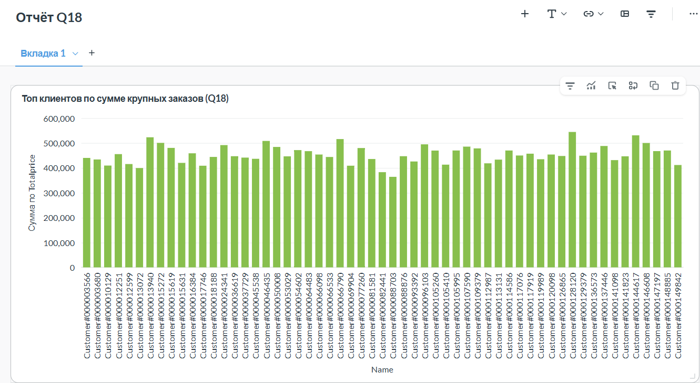

# Отчёт по практической №1 (Вариант 3 — Q18)

**ФИО (как в VK Education):** *[Базырова Тамара]*
**Ссылка на репозиторий:** *[https://github.com/tomatoma0/lakehouse-q18]*

## 1. Вариант и масштаб
| Поле | Значение |
|---|---|
| Вариант (запрос) | Q18 «Large Volume Customer» |
| Масштаб `sfN` | `sf3` (17 996 609 строк в lineitem) |
| Почему выбрал такой масштаб | `sf1` не даёт наглядной разницы между кодеками из-за малого объёма (всё кэшируется). `sf10` требует слишком много времени на запись. `sf3` — оптимальный компромисс: заметная разница в размерах файлов и приемлемое время выполнения. |

## 2. Поднятые сервисы — и почему именно они
| Сервис | Роль в стеке | Почему именно он |
|---|---|---|
| MinIO (SILO) | S3-совместимое объектное хранилище | Бесплатный open-source форк, совместимый с S3 API. Легко разворачивается в Docker. |
| PostgreSQL | БД для метаданных Lakekeeper | Надёжная реляционная БД, стандарт для хранения состояния каталогов. |
| Lakekeeper | Iceberg REST Catalog | Открытый каталог, соответствующий спецификации Iceberg REST. Позволяет Trino и Spark работать с одними и теми же таблицами. |
| Trino | SQL-движок | Быстрый интерактивный движок для ad-hoc аналитики. Отлично работает с Iceberg через REST. |
| Metabase | BI-инструмент | Легковесная визуализация. Подключён к Trino через драйвер Starburst. |

**Скрипты поднятия стека:**
*(Кратко опиши команды, которые ты выполняла. Например: `docker run -d --name lakehouse-minio ...`)*

## 3. Разбор запроса Q18 — какие данные нужны
| Таблица TPC-H | Нужные колонки | Что делает запрос |
|---|---|---|
| `customer` | `custkey`, `name` | Джойн с `orders` по `custkey`, вывод имени клиента |
| `orders` | `orderkey`, `custkey`, `orderdate`, `totalprice` | Джойн с `lineitem`, вывод даты и суммы заказа |
| `lineitem` | `orderkey`, `quantity` | Подзапрос для фильтрации заказов (`HAVING sum(quantity) > 300`), агрегация количества |

## 4. Медальон — решения по каждому слою

### Bronze (сырой)
| Таблица | Строк | Формат | Сжатие | Партиционирование | Обоснование |
|---|---|---|---|---|---|
| `raw_customer` | 150 000 | Parquet | SNAPPY | Нет | Сырые данные, дефолтный кодек Iceberg. Партиционирование не нужно. |
| `raw_orders` | 1 500 000 | Parquet | SNAPPY | Нет | » |
| `raw_lineitem` | 17 996 609 | Parquet | SNAPPY | Нет | » |

### Silver (очищенный)
| Таблица | Строк | Формат | Сжатие | Партиционирование | Обоснование |
|---|---|---|---|---|---|
| `silver_large_orders` | 57 | Parquet | SNAPPY | Нет | Отфильтрованы только «крупные» заказы (>300 единиц), обогащены данными клиента. Мало строк, партиционирование не имеет смысла. |

### Gold (витрина)
| Таблица | Строк | Формат | Сжатие | Партиционирование | Обоснование |
|---|---|---|---|---|---|
| `gold_q18` | 57 | Parquet | SNAPPY | Нет | Готовый ответ для бизнеса (топ-100). Объём крошечный, кодирование/партиционирование избыточно. |

## 5. Тесты производительности (Бенчмарк)

Замеры проводились на `sf3` (17 996 609 строк). Время записи получено из логов Trino (`system.runtime.queries`).

| Вариант | Размер, МБ | Время записи, с | Агрегация cold, с | Агрегация warm, с |
|---|---|---|---|---|
| **parquet_none** | 1082.1 | 57.2 | 8.31 | 9.23 |
| **parquet_snappy** | 595.1 | 41.7 | 6.39 | 6.66 |
| **parquet_gzip** | 431.7 | 53.3 | 5.43 | 5.06 |
| **parquet_zstd** | 442.0 | 39.0 | 7.03 | 5.55 |
| **orc_none** | 1297.1 | 65.3 | 21.00 | 24.00 |
| **orc_snappy** | 634.5 | 50.7 | 10.00 | 10.00 |
| **orc_gzip** | 451.1 | 50.9 | 6.49 | 7.01 |
| **orc_zstd** | 466.3 | 42.4 | 7.07 | 7.11 |

**Выводы по бенчмарку:**
1. **Размер:** `parquet_gzip` показал наименьший размер (431.7 МБ). Parquet сжимается лучше ORC на 5-10%. Использование кодеков ZSTD/GZIP уменьшает размер в 2.4–2.8 раза по сравнению с NONE.
2. **Запись:** `parquet_zstd` записался быстрее всех (39 с). Кодек NONE пишет больше данных на диск, из-за чего упирается в I/O и работает медленнее сжатых аналогов.
3. **Чтение:** `parquet_gzip` показал лучшую скорость чтения (5.06 с warm). `orc_none` — худший результат (24 с), так как файлы огромные и не влезают в кэш.
4. **Компромисс:** **ZSTD** — оптимальный выбор по умолчанию (хорошее сжатие + быстрая запись). **GZIP** — если критично место. **SNAPPY** — если слабый CPU. **NONE** — только для временных данных.

## 6. Часть 2 — осмысление и работа с инструментами

### 6.1. Понять и объяснить
* **Зачем нужны большие данные и lakehouse:** Обычные БД не справляются с петабайтами неструктурированных данных. Lakehouse сочетает дешевизну Data Lake (S3) и ACID-транзакции Data Warehouse.
* **Пример schema evolution на Silver:** Если бы в `silver_large_orders` понадобилось добавить колонку `customer_segment`, в Iceberg можно было бы использовать `ALTER TABLE ADD COLUMN customer_segment VARCHAR`. Iceberg обновит метаданные, а старые Parquet-файлы останутся неизменными (новая колонка будет возвращать `NULL` для них).
* **Пример скрипта восстановления (time travel):** `SELECT * FROM gold_q18 VERSION AS OF 'timestamp'` или `ROLLBACK TO SNAPSHOT 'id'`. Это позволяет откатить данные при ошибочном ETL.

### 6.2. Подключить инструмент к lakehouse
* **Инструмент:** Metabase (BI-система).
* **Почему выбрал:** Лёгкая в развертывании, имеет готовый драйвер Starburst для Trino. Позволяет бизнес-пользователям строить графики без SQL.
* **Действия:** Запущен в Docker с плагином Starburst. В настройках подключён к Trino (Host: `host.docker.internal`, Port: `8080`, Catalog: `lakekeeper`). Построена столбчатая диаграмма на основе Gold-витрины `gold_q18` (Топ клиентов по сумме крупных заказов).

## 7. Выводы
В ходе работы был успешно развернут локальный Lakehouse на базе MinIO, Lakekeeper и Trino. Построена медальон-архитектура для данных TPC-H (Вариант Q18): Bronze (сырые данные), Silver (отфильтрованные «крупные» заказы), Gold (готовая витрина для BI). Проведен масштабный бенчмарк 8 комбинаций форматов и кодеков. Выяснено, что Parquet с ZSTD/GZIP обеспечивает наилучший баланс между размером, скоростью записи и чтения. Инструмент визуализации Metabase доказал, что данные из Lakehouse могут быть легко доступны бизнесу.